# Kaelora

**Construa sua cidade, monte um esquadrão de 5 personagens entre mais de 1000 e invada cidades de outros jogadores por uma estrada que liga as duas. Se o seu Núcleo cair, sua cidade é saqueada, e a vingança começa.**

Jogo de estratégia e ação em **Voxel Toon** (era futurista-tropical) para celular, feito como **PWA instalável**: abre no navegador, instala na tela inicial e roda em tela cheia, deitado. Um projeto da **Klipza Studio**.

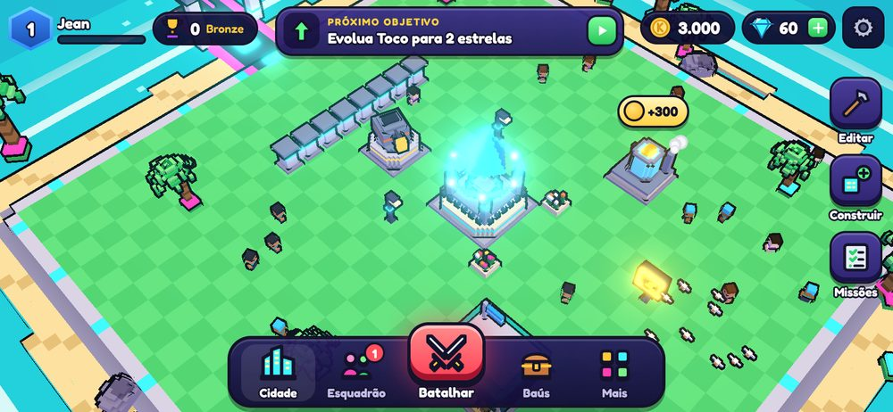

---

## Sumário

- [Galeria](#galeria)
- [O que tem no jogo](#o-que-tem-no-jogo)
- [Como jogar](#como-jogar)
- [Instalar no celular (PWA)](#instalar-no-celular-pwa)
- [Rodar o projeto](#rodar-o-projeto)
- [Arquitetura](#arquitetura)
- [Modo online com Supabase](#modo-online-com-supabase)
- [Publicar na Vercel](#publicar-na-vercel)
- [Balanceamento sem mexer em código](#balanceamento-sem-mexer-em-código)
- [Testes](#testes)
- [Estado do projeto e limitações conhecidas](#estado-do-projeto-e-limitações-conhecidas)
- [Créditos](#créditos)

---

## Galeria

| | |
|---|---|
| 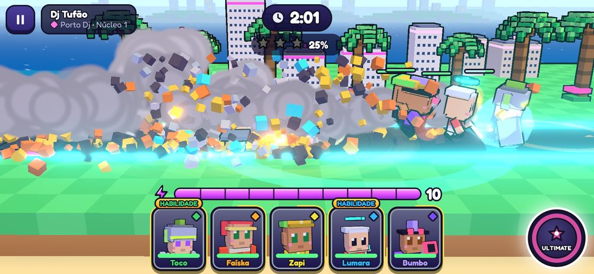 | 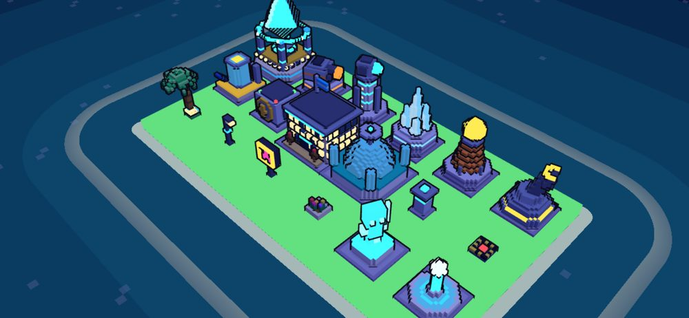 |
| **Batalha** na vista lateral da estrada: cartas, energia, habilidades e Ultimate | **Noite** na cidade: janelas e néon acendem sozinhos |
| 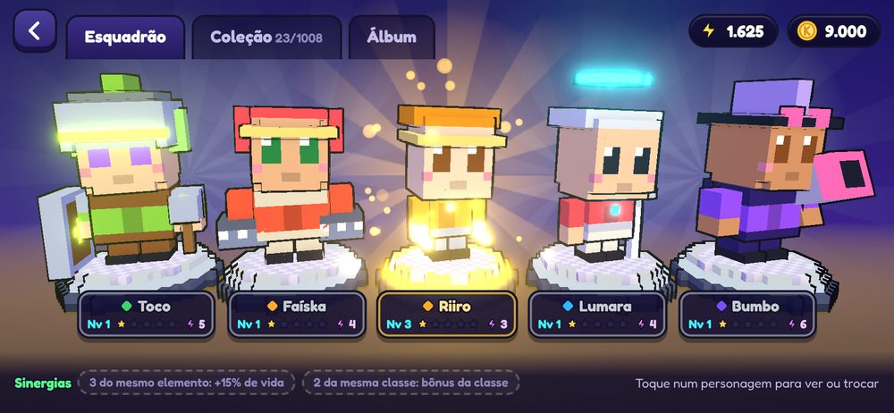 | 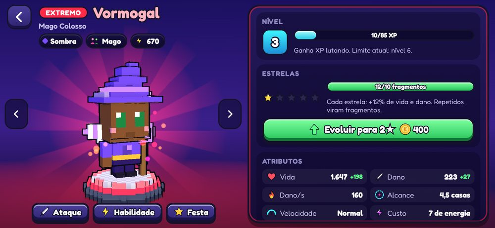 |
| **Esquadrão** com sinergias ativas | **Personagem** em 3D, atributos, estrelas e evolução |
| 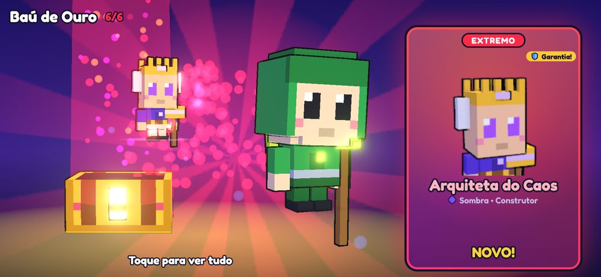 | 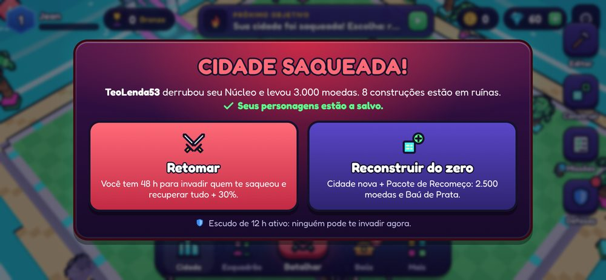 |
| **Baú** abrindo com garantia de Extremo | **Cidade saqueada**: retomar em 48 h ou recomeçar |
| 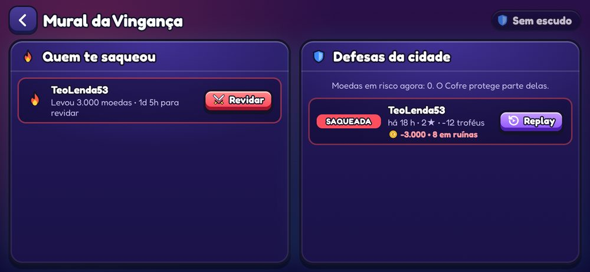 | 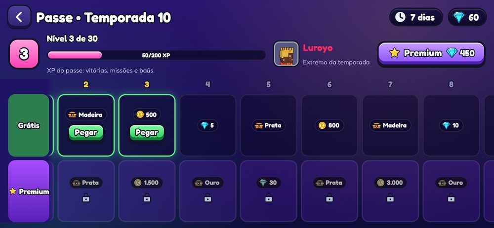 |
| **Mural da Vingança** com replay do ataque | **Passe de temporada** grátis e premium |
| 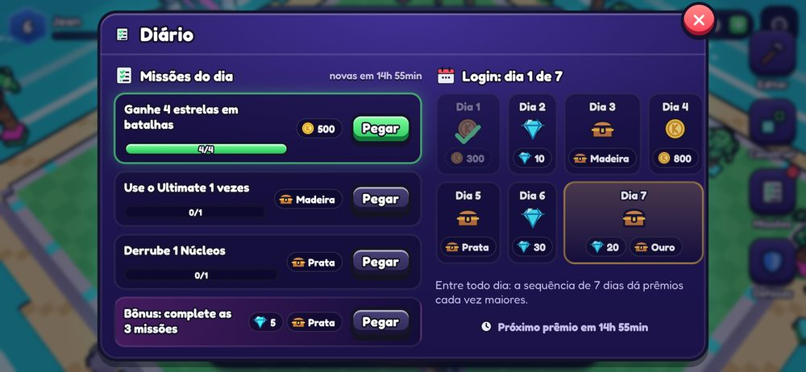 | 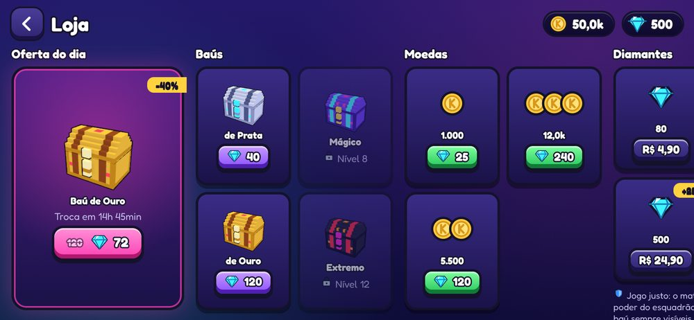 |
| **Diário**: missões e login de 7 dias | **Loja** com chances sempre visíveis |
| 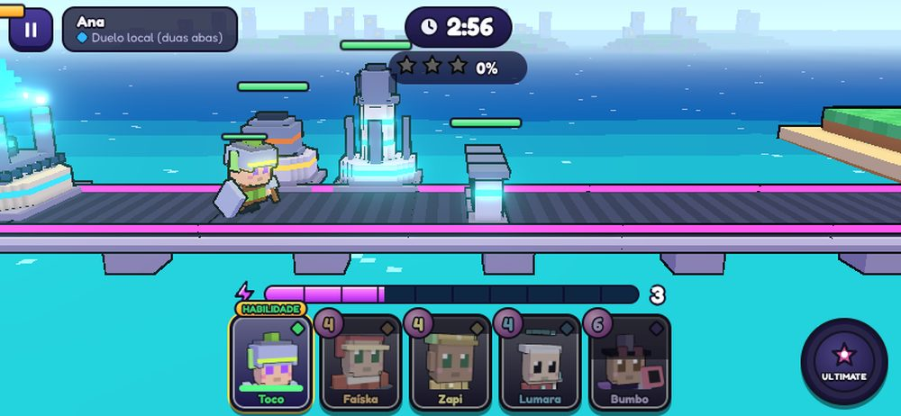 | |
| **Duelo ao vivo 1v1** em lockstep | |

> As capturas são da tela de 844×390 (celular deitado), o tamanho de referência do projeto.

---

## O que tem no jogo

Tudo segue a especificação do [`CLAUDE.md`](CLAUDE.md), construída em 8 fases. O registro detalhado de cada fase está em [`PROGRESS.md`](PROGRESS.md).

### Cidade (vista de cima)
- Câmera isométrica de toque: arrastar com inércia, pinça para zoom, toque para selecionar.
- Grade de 24×24 que cresce até 40×40 com o nível do Núcleo.
- **Modo edição**: arrastar e soltar, girar, guardar no estoque, pegada verde/vermelha e a **ordem das defesas na estrada** em selos numerados (a defesa segue a distância até a entrada).
- Construções: Núcleo, Barreiras/Muralhas, 5 torres (Canhão, Laser, Gelo, Tesla, Morteiro), Armadilhas escondidas, Gerador de moedas, Cofre, Quartel, Laboratório e decorações. Todas com nível, vida, custo e tempo em `src/data/buildings.json`.
- Melhorias em tempo real com 2 construtores e aceleração por diamantes.
- **Ciclo de dia e noite**, oceano toon com espuma, nuvens voxel, moradores andando, carros flutuantes, barcos, pássaros que dormem à noite e fumaça.

### Batalha (vista lateral 2.5D)
- Transição de 1,5 s: a câmera mergulha da cidade para a estrada, com som e linhas de velocidade.
- 5 cartas na mão, **energia** (máx. 10, +1 a cada 1,5 s, cartas de 2 a 7), personagem volta para a mão depois da recarga.
- Ataque automático + **1 habilidade** por personagem (toque no retrato) + **Ultimate do esquadrão** que enche com o dano e dispara em câmera lenta.
- 3 minutos de partida, **Frenesi** nos últimos 30 s (energia 2×). Estrelas: 50% destruído, Núcleo derrubado, vitória com 60 s ou mais sobrando.
- **Juice**: hit stop, tremor proporcional ao dano, números flutuantes (crítico amarelo), combos, explosões voxel com física, câmera lenta na queda do Núcleo, vibração do celular e som em camadas.
- Replays compartilháveis por link (`#replay=`).

### Personagens (1008)
- 12 classes × 6 elementos × 14 variantes = **1008 personagens** gerados por código, cada um com nome único, visual voxel único, atributos e habilidade. Raridades exatas: Comum 400, Raro 300, Épico 180, Lendário 96, Extremo 32.
- Dois ciclos de vantagem (+30% de dano): **Solar > Raiz > Maré > Solar** e **Volt > Cristal > Sombra > Volt**.
- **60 personagens feitos à mão** com visual, habilidade, falas e uma linha de história.
- Começo com 5 Comuns fracos; duplicatas viram fragmentos; estrelas de 1 a 5; nível limitado pelo Quartel.
- Sinergias (3+ do mesmo elemento: +15% de vida; 2 da mesma classe: bônus da classe), Coleção com filtros e **Álbum** com marcos de 10/25/50/75/100% por elemento.

### Baús e economia
- 5 baús (Madeira, Prata, Ouro, Mágico, Extremo) com a tabela de chances da especificação, **sempre visível antes de abrir**.
- Garantia: Lendário a cada 40 baús de Ouro ou melhores sem Lendário; Extremo a cada 150.
- Abertura em 3D: o baú treme, a fresta brilha na cor da melhor raridade, a tampa explode em luz e a carta gira e revela. Lendário e Extremo têm cena especial em câmera lenta.
- Moedas, diamantes, nível de conta (cada nível libera algo) e troféus.

### Online, saque e vingança
- **Invasão PvP assíncrona**: você ataca a cidade de outro jogador e a defesa é a IA usando o layout salvo dele.
- Núcleo derrubado = **cidade SAQUEADA**: perde as moedas fora do Cofre, construções viram ruína, **a coleção nunca é perdida**.
- Escolha entre **Reconstruir do zero** (Pacote de Recomeço) ou **Retomar** (48 h para revidar e recuperar tudo + 30%).
- Escudo de 12 h, proteção de iniciante (72 h ou até o nível 5) e **Mural da Vingança** com replay do ataque visto do lado da defesa.
- Sem servidor configurado, rivais-bot também atacam a cidade enquanto você está fora.

### Retenção
- 3 missões diárias, baú grátis a cada 4 h (até 2 guardados), sequência de login de 7 dias.
- Ligas Bronze, Prata, Ouro, Diamante, Mestre e Extremo com prêmio e reset semanal.
- Eventos semanais com regra especial (Núcleo Titã, Energia Turbo, Torres Furiosas, Blitz de 90 s, Semanas de Elemento).
- **Passe de temporada** de 30 dias (trilha grátis e premium) com um Extremo exclusivo no fim.
- Notificações do PWA: baú pronto, melhoria concluída, escudo acabando, evento novo e cidade atacada.

### Conteúdo e multiplayer
- **Treinamento** com 4 dificuldades (nada se perde) e tutorial guiado nas 3 primeiras batalhas.
- **Laboratório** com pesquisas permanentes, **Loja** com oferta do dia, **Perfil** com avatar e conquistas, **Ranking** e **Configurações** (som, música, gráficos Baixo/Médio/Alto, vibração, conta).
- **Duelo ao vivo 1v1**: os dois na mesma estrada, cada um atacando o Núcleo do outro, sincronizados em lockstep. Funciona online (Supabase Realtime), entre duas abas do mesmo aparelho (sem servidor) ou contra um bot.

---

## Como jogar

| Onde | Gesto | O que faz |
|---|---|---|
| Cidade | Arrastar | Move a câmera |
| Cidade | Pinça (ou roda do mouse) | Zoom |
| Cidade | Tocar numa construção | Abre o painel (melhorar, coletar, reparar) |
| Edição | Arrastar uma construção | Muda de lugar (verde = pode, vermelho = não pode) |
| Batalha | Tocar numa carta | Coloca o personagem na estrada (gasta energia) |
| Batalha | Tocar no retrato com o anel cheio | Usa a **habilidade** |
| Batalha | Botão **ULTIMATE** cheio | Ataque especial do esquadrão em câmera lenta |
| Baú | Tocar | Pula a animação (depois da primeira vez de cada tipo) |

O botão **BATALHAR** abre o Mapa de Invasão. A barra de **próximo objetivo** no topo da cidade sempre diz o que fazer agora.

---

## Instalar no celular (PWA)

O jogo é um **Progressive Web App**: depois de publicado (veja [Publicar na Vercel](#publicar-na-vercel)), basta abrir o link.

- **Android (Chrome)**: abra o site, toque no menu **⋮** e em **Instalar app** (ou **Adicionar à tela inicial**). O ícone aparece junto com os outros apps e o jogo abre em tela cheia, deitado.
- **iPhone/iPad (Safari)**: abra o site, toque em **Compartilhar** e em **Adicionar à Tela de Início**. Gire o aparelho para paisagem.
- **Computador (Chrome/Edge)**: o ícone de instalar aparece na barra de endereço.

Depois de instalado, o jogo funciona **offline** (o service worker guarda tudo no aparelho). Quando sai uma versão nova, aparece um aviso para atualizar.

---

## Rodar o projeto

**Requisitos:** Node.js **20.19 ou mais novo** (recomendado 22) e npm.

```bash
npm install
npm run dev
```

Abra `http://localhost:5173`. O servidor de desenvolvimento roda com `--host`, então dá para abrir pelo celular na mesma rede Wi-Fi usando o IP do computador (o Vite mostra o endereço no terminal). Use o modo de dispositivo do navegador em **844×390** para simular um celular deitado.

O service worker só é gerado no build. Para testar o PWA instalável de verdade:

```bash
npm run build
npm run preview
```

### Scripts

| Comando | O que faz |
|---|---|
| `npm run dev` | Servidor de desenvolvimento (Vite) acessível na rede local |
| `npm run build` | Build de produção em `dist/` (com service worker e manifest) |
| `npm run preview` | Serve o build de produção localmente |
| `npm run typecheck` | Checagem de tipos (TypeScript strict) |
| `npm test` | Roda todos os testes (Vitest) |
| `npm run test:watch` | Testes em modo observação |
| `npm run icons` | Gera os ícones do PWA por código em `public/icons/` |
| `npm run characters` | Regenera `src/data/characters.json` a partir do gerador |
| `npm run build:server` | Empacota o servidor do jogo para as Edge Functions (`supabase/functions/_shared/kaelora-server.js`) |

---

## Arquitetura

**Stack:** Three.js + TypeScript (strict) + Vite, PWA com `vite-plugin-pwa`, UI em HTML/CSS por cima do canvas, Supabase (Auth, Postgres com RLS, Realtime e Edge Functions) e Vitest. Fonte Fredoka. Nenhum modelo 3D, textura ou som vem de arquivo: **tudo é gerado por código** (voxels procedurais e síntese de áudio com Web Audio).

```
src/
  core/      loop do jogo, cenas, input de toque, save (IndexedDB), áudio procedural, notificações
  sim/       simulação de batalha DETERMINÍSTICA (sem Three.js, sem DOM)
  render/    gerador voxel, material toon, contorno, partículas, câmeras, dia e noite, vitrine 3D
  scenes/    city/, battle/, chest/, menus/
  content/   gerador dos 1008 personagens, nomes, habilidades, cidades-bot, treinos, duelos
  meta/      regras do jogo (cidade, coleção, baús, saque, missões, passe...) como ações puras
  data/      JSON de construções, baús, economia, eventos, pesquisas, conquistas e personagens
  ui/        telas, painéis, HUD e estilos
  net/       cliente Supabase, lockstep, transportes e lobby do duelo
  server/    servidor autoritativo (independente de banco), empacotado para as Edge Functions
supabase/
  migrations/  tabelas, RLS, view de ranking, função de matchmaking
  functions/   bootstrap, game-action, open-chest, matchmaking, validate-battle,
               apply-raid, claim-reward, duel-submit
tests/         Vitest
docs/          capturas de tela do README
```

### Como as peças conversam

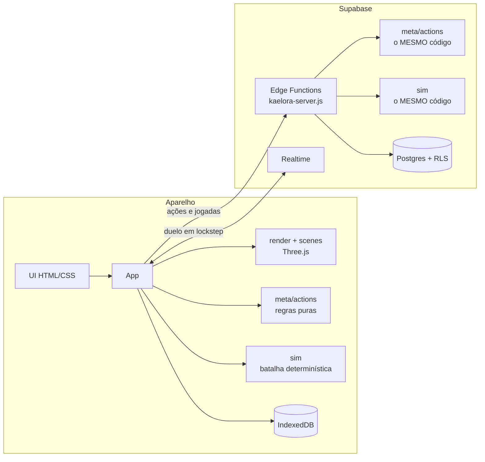

### Regras de ouro

- **Simulação determinística**: `src/sim` roda em tick fixo de 30 Hz, com matemática inteira e RNG por semente (sfc32). Nada de `Math.random()` nem `Date.now()` lá dentro (um teste varre a pasta para garantir). A mesma semente + as mesmas jogadas = o mesmo resultado, sempre. É isso que permite replay, validação no servidor e duelo ao vivo.
- **Uma regra, um lugar**: toda mudança no save é uma ação pura em `src/meta/actions.ts`. Offline, o aparelho executa direto. Online, o aparelho aplica as ações determinísticas na hora (otimista) e o servidor repete e confirma. Sorteios (baús, alvos, semente da batalha) só acontecem no servidor.
- **O cliente nunca define valores**: online, moedas, diamantes, baús e resultados são escritos só pelas Edge Functions, que re-simulam a batalha com a semente secreta para confirmar o resultado.
- **Desempenho**: InstancedMesh, greedy meshing com faces internas removidas, merge de geometria, cache LRU dos personagens, pooling de partículas, render pausado atrás de telas opacas e 3 presets de gráficos com detecção automática.

---

## Modo online com Supabase

O jogo funciona **100% offline** sem configurar nada (save no aparelho, rivais-bot). Para ligar o modo online (contas, PvP real, ranking global, duelo pela internet):

1. **Crie um projeto** em [supabase.com](https://supabase.com).
2. **Autenticação** (Authentication → Sign In / Providers):
   - ative **Allow anonymous sign-ins** (o jogador entra como convidado e vincula um e-mail depois);
   - deixe o provedor **Email** ligado (link mágico);
   - em **URL Configuration**, coloque o endereço do jogo em *Site URL* e em *Redirect URLs* (ex.: `https://seu-jogo.vercel.app` e `http://localhost:5173`).
3. **Banco de dados**: com o [Supabase CLI](https://supabase.com/docs/guides/cli), ligue a pasta ao projeto e aplique as migrações:
   ```bash
   npx supabase login
   npx supabase link --project-ref SEU_PROJECT_REF
   npx supabase db push
   ```
   Isso cria todas as tabelas com RLS (`player_state`, `profiles`, `cities`, `owned_characters`, `squads`, `battles`, `chests`, `raid_status`, `missions`, `events`, `season_pass`, `duels`), a view `leaderboards`, a função de matchmaking e o tempo real em `raid_status`.
4. **Edge Functions**: empacote o servidor do jogo e publique as funções:
   ```bash
   npm run build:server
   npx supabase functions deploy
   ```
   As funções usam automaticamente `SUPABASE_URL`, `SUPABASE_ANON_KEY` e `SUPABASE_SERVICE_ROLE_KEY` do projeto. Opcional: limite o CORS ao seu domínio com
   ```bash
   npx supabase secrets set KAELORA_ALLOWED_ORIGIN=https://seu-jogo.vercel.app
   ```
5. **Cliente**: copie `.env.example` para `.env.local` e preencha com os valores de *Project Settings → API*:
   ```bash
   VITE_SUPABASE_URL=https://SEU-PROJETO.supabase.co
   VITE_SUPABASE_ANON_KEY=sua-chave-anon-publica
   ```
   Rode `npm run dev` de novo. Em **Configurações → Jogo online**, o jogador entra como convidado ou por link mágico no e-mail, e o progresso que já estava no aparelho vai para a nuvem (com limites anti-trapaça). A partir daí o servidor é quem manda.

> A chave **anon** é pública por natureza (vai no navegador). A chave **service_role** fica só nas Edge Functions e nunca deve ir para o `.env` do cliente.

**Sempre que mudar algo em `src/meta`, `src/sim`, `src/content` ou `src/data`**, rode `npm run build:server` e publique as funções de novo, para o servidor continuar rodando exatamente as mesmas regras do aparelho.

---

## Publicar na Vercel

1. Em [vercel.com](https://vercel.com), **Add New → Project** e importe este repositório do GitHub.
2. A Vercel detecta o Vite sozinha. Confira: *Build Command* `npm run build`, *Output Directory* `dist`.
3. (Opcional, para o modo online) em **Settings → Environment Variables**, adicione `VITE_SUPABASE_URL` e `VITE_SUPABASE_ANON_KEY`.
4. **Deploy**. Cada push na `main` publica uma versão nova, e o jogo instalado avisa o jogador para atualizar.

O build usa caminhos relativos (`base: './'`), então também funciona em qualquer hospedagem estática (Netlify, GitHub Pages, Cloudflare Pages) servindo a pasta `dist/`.

---

## Balanceamento sem mexer em código

Todos os números do jogo ficam em JSON:

| Arquivo | O que controla |
|---|---|
| `src/data/economy.json` | Energia, recompensas de batalha, troféus, XP de conta, ligas, missões, login, baú grátis, passe, saque, escudo, proteção, loja, força dos rivais-bot |
| `src/data/buildings.json` | Construções: vida, dano, alcance, custo e tempo por nível, limites por nível do Núcleo |
| `src/data/chests.json` | Chances de cada baú, número de cartas, moedas, diamantes, garantias e bloqueios |
| `src/data/events.json` | Eventos semanais e suas regras |
| `src/data/research.json` | Pesquisas do Laboratório |
| `src/data/achievements.json` | Conquistas e seus degraus |
| `src/data/characters.json` | Os 1008 personagens (gerado por `npm run characters`) |

Depois de mudar um JSON, rode `npm test` (os testes de baús conferem a tabela de chances da especificação) e, se o online estiver ligado, `npm run build:server` + deploy das funções.

---

## Testes

```bash
npm test
```

**96 testes** cobrindo: determinismo da simulação, replay, energia, Frenesi, cartas, vantagem de elemento, estrelas, armadilhas, gerador dos 1008 personagens (unicidade de nomes e visuais, distribuição de raridades), coleção, evolução, álbum, chances dos baús (incluindo distribuição real com 60 mil cartas e a garantia), economia da cidade, saque, Cofre, escudo, proteção de iniciante, vingança, servidor autoritativo (PvP completo, tentativa de trapaça, concorrência), missões, login, ligas, eventos, passe, laboratório, loja, conquistas, lockstep com latência, perda de pacotes, queda e reconexão, e o servidor do duelo.

---

## Estado do projeto e limitações conhecidas

As 8 fases da especificação estão implementadas, com typecheck, build e testes passando. Para ser transparente sobre o que ainda falta:

- **Online não foi exercitado contra um projeto Supabase real.** O servidor foi testado em memória (Vitest), o bundle rodou no Deno e as 8 Edge Functions passam no `deno check`. O duelo ao vivo foi testado com duas abas reais (BroadcastChannel), que usa o mesmo protocolo do Realtime.
- **Compra de diamantes com dinheiro real está desligada** (os pacotes aparecem na Loja, mas falta ligar um provedor de pagamento).
- **Notificações com o app fechado** precisam de Web Push no servidor. Hoje elas são agendadas quando o app vai para segundo plano e dependem do sistema mantê-lo vivo.
- Trocar de/para o preset de gráficos **Baixo** só muda o antialias depois de recarregar a página.
- A importação do progresso do aparelho para a nuvem tem limites anti-trapaça, mas um save local editado ainda pode ganhar alguma vantagem uma única vez.

Detalhes por fase em [`PROGRESS.md`](PROGRESS.md).

---

## Créditos

**Kaelora** é um jogo da **Klipza Studio**.

Todos os nomes, personagens, modelos, sons e a identidade visual são originais e gerados por código para este projeto. Bibliotecas: [Three.js](https://threejs.org), [Vite](https://vite.dev), [vite-plugin-pwa](https://vite-pwa-org.netlify.app), [Supabase](https://supabase.com), [Vitest](https://vitest.dev) e a fonte [Fredoka](https://fonts.google.com/specimen/Fredoka).

© Klipza Studio. Todos os direitos reservados.
